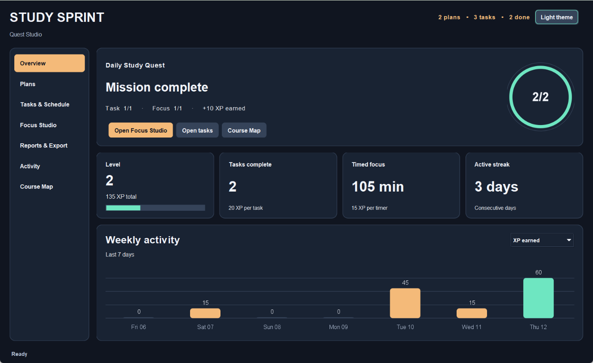

# Study Sprint 3.0 — Quest Studio

An offline study planner built with Java 17 and Swing. Import coursework, compare schedules, map your workload, and earn progress by finishing tasks and focus sessions.



## Start and test

Install JDK 17 or newer and make sure `java` and `javac` are available in the terminal. A graphical desktop is required to open the app. The app uses the Java standard library.

| Platform | Open the app | Run the automated tests |
|---|---|---|
| Windows CMD or PowerShell | `.\scripts\run.bat` | `.\scripts\test.bat` |
| Linux or macOS | `bash scripts/run.sh` | `bash scripts/test.sh` |

Run from the extracted project folder. The scripts compile for Java 17. Maven users can run `mvn test`, then launch with `java -cp target/classes app.Main`.

The first run creates two plans, three tasks, and a manual focus entry. Data is saved to `data/study-sprint.properties`. Pass `--data data/demo.properties` to a launch script for an isolated demo. To use a file from an earlier release, close both versions and launch with a copy of that file. Older undated completions retain their status and XP. Older focus entries remain manual. Use one app window per data file.

## Demonstrate the main journey

1. In **Plans**, create a plan with a study goal.
2. In **Tasks & Schedule**, select that plan, choose **Import CSV**, open `sample-data/tasks-import.csv`, review the rows, and confirm. Switch between **Priority first** and **Shortest first** to compare their suggested order.
3. In [**Course Map**](docs/images/course-map-dark.png), select the workspace, a plan, and a task. Compare completion and remaining estimates at each level. **Open plan tasks** returns to the selected plan.
4. In [**Tasks & Schedule**](docs/images/tasks-dark.png), choose **Complete / reopen** for one task, then **Undo** and **Redo**. See the changes in **Overview**, **Course Map**, and **Activity**.
5. In [**Focus Studio**](docs/images/focus-light.png), select a task and set one minute for the demo. Start, pause, resume, and wait until the countdown reaches zero. Choose **Finish & save**, then check the daily mission and switch the weekly chart between **XP earned** and **Focus minutes** in **Overview**.
6. In **Reports & Export**, toggle task and focus sections and export TXT or CSV. Restart with the same data file to check the saved task status, focus log, and XP.

## Import a CSV

Save a UTF-8 file with this header and one row per task.

```csv
title,minutes,priority,due
"Review graphs, trees and heaps",40,5,2027-01-21
Solve recurrence exercises,15,2,2027-01-23
```

Dates use `YYYY-MM-DD`, estimates range from 1 to 1440 minutes, and priority ranges from 1 to 5. Import also accepts a Study Sprint CSV report and reads its task rows. Each imported task starts unfinished with a new ID. A file can contain up to 500 tasks and be up to 1 MiB. All tasks in the batch must pass validation before the plan is saved.

## Progress and history

- Each currently completed task contributes 20 XP. Its first completion date drives the chart and daily mission. Reopening reverses its contribution. Completing it again restores the original date.
- A saved timer contributes 15 XP. Focus Studio has 15, 25, and 50 minute presets and accepts a custom duration from 1 to 120 minutes. Only active countdown time counts. Choose **Finish & save** at zero to keep the session.
- The daily mission awards 10 XP when a dated task completion and a saved timer occur on the same day. Each 100 XP advances one level. The chart covers the last seven calendar days. A streak ends today or, if today has no activity yet, yesterday.
- **Log manually** keeps a record for reports. Only saved timers count toward XP. Changing the minutes or date of a timed record converts it to a manual entry.
- **Undo** and **Redo** apply to task completion changes in the current window. The app saves each change, including undo and redo. History clears on task or plan deletion and when the app closes. Deleting a plan removes its tasks and associated sessions.
- Theme selection applies to the current launch.

## Ten patterns in use

The six core patterns remain part of the final project. The four additions extend working app flows.

| Pattern | Participants | What to demonstrate |
|---|---|---|
| Builder | `StudyTask.Builder`, `StudyTask` | Add or edit a validated task with an estimate, priority, and due date. |
| Factory Method | `ExportService`, `TextExportService`, `CsvExportService`, `ReportFormatter` | Export both formats. Each exporter creates its own formatter. |
| Decorator | `SummaryComponent`, `BaseSummary`, `SummaryDecorator`, `ProgressSummaryDecorator`, `FocusSummaryDecorator` | Toggle the two optional sections in the report preview. |
| Facade | `StudyPlannerFacade`, `PlannerFrame`, `StudyRepository` | Save a timer through one UI call that validates, persists, and publishes. |
| Strategy | `SchedulingStrategy`, `PriorityStrategy`, `ShortestTaskStrategy` | Change task order without editing the plan. |
| Observer | `StudyEventHub`, `StudyEventListener`, `PlannerFrame` | Complete a task and watch Overview, Course Map, and Activity update. |
| Adapter | `TaskImportSource`, `CsvTaskImportAdapter`, `CsvTableReader` | Preview and import either CSV format into a plan. |
| Composite | `WorkloadNode`, `CourseMap`, `Branch`, `TaskNode`, `CourseMapPanel` | Compare workload totals at the workspace, plan, and task levels. |
| Command | `StudyCommand`, `ToggleCompletionCommand`, `CommandHistory`, `StudyPlannerFacade` | Complete, undo, and redo a task while the UI and saved status follow each operation. |
| State | `FocusTimer`, `TimerState`, `Idle`, `Running`, `Paused`, `Finished` | Pause and resume the countdown, then save it at zero. |

`StudyPlan`, `StudyTask`, and `FocusSession` are related by IDs. The facade saves a complete snapshot before publishing an event. Overview and Course Map derive their totals from the saved model.

## Documentation and defense

- `docs/StudySprint_Final_Report.pdf` and `docs/StudySprint_Final_Report.docx` contain the report.
- `docs/class-diagram.puml` and `docs/sequence-diagram.puml` contain UML sources. `docs/images/` contains rendered diagrams and screenshots with illustrative local data.
- `docs/test-scenarios.csv` describes the inputs and outcomes for 23 automated tests. `docs/test-results.txt` records the latest automated run.
- `docs/DEFENSE_GUIDE.md` and `START_HERE_RU.md` cover the walkthrough and individual defense. `CHANGELOG.md` records changes by release.

Before submission, enter real team names, pattern ownership, actual contributions, and the GitHub or GitLab URL showing your development history. Each student should independently test and adapt their work, then practice explaining and modifying their own patterns. Codex assisted with this revision, documentation, and verification. Follow the course rules for disclosing AI use and independent development.
